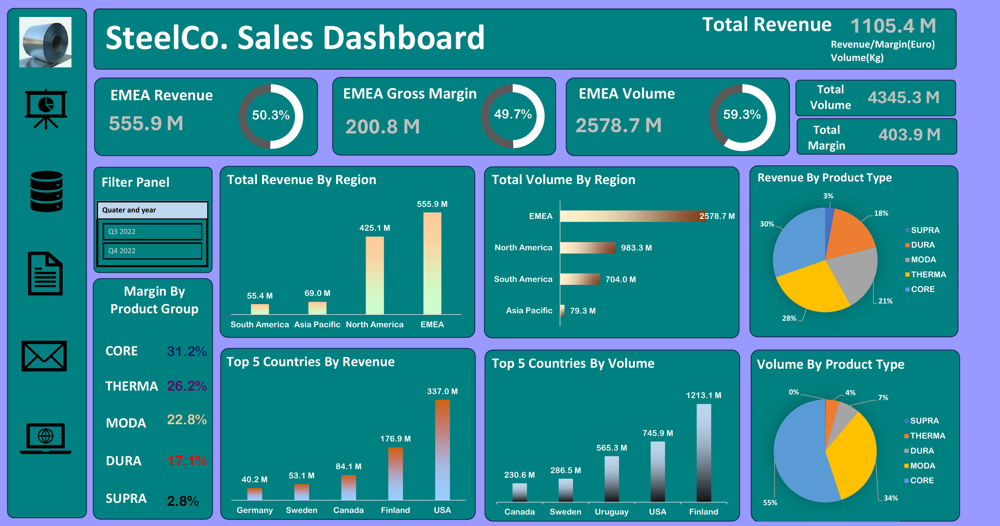
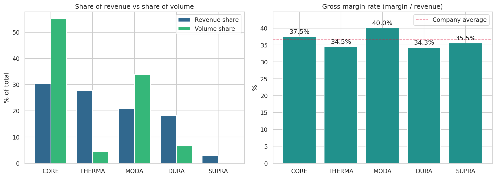
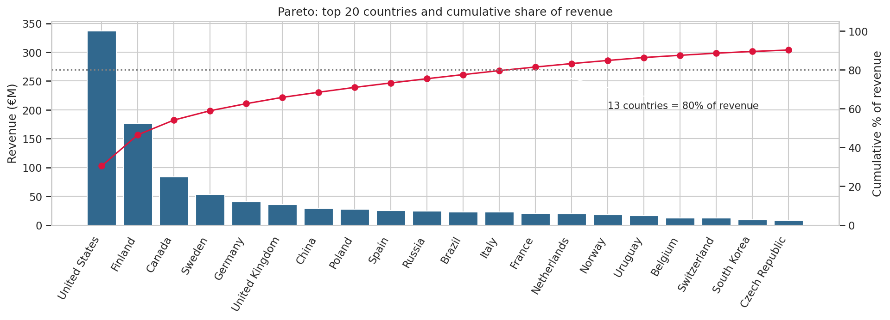

# SteelCo Business Analysis

End-to-end sales analysis of **SteelCo Ltd** (Q3-Q4 2022): an interactive Excel sales dashboard, a comparison with the global steel market, and a **Python data cleaning and visualisation workflow** (pandas, matplotlib, seaborn).

## Dashboard



*Excel dashboard built from pivot tables, with a quarter filter and hyperlinks. [PDF version](dashboard/SteelCo_Dashboard.pdf)*

## Project objective

1. Create a **Sales Dashboard** ([dashboard/](dashboard/)).
2. Compare **SteelCo with the global steel market** ([presentation/Steel_Industry_Insights.pdf](presentation/Steel_Industry_Insights.pdf)).
3. Clean and re-analyse the data in **Python** to validate the dashboard and extract further insights ([notebooks/SteelCo_Analysis.ipynb](notebooks/SteelCo_Analysis.ipynb)).

**Why sales analytics matters:** it lets a business monitor sales performance, spot patterns, track KPIs and identify the main contributors to revenue.

**Role of this report:** identify the strongest customer segments, position the company against the global trend, find expansion opportunities and plan next steps.

## Python data analysis

The notebook and script work on the raw sheet (4,134 transaction rows: product group, steel grade, region, country, quarter, volume kg, revenue EUR, gross margin EUR).

### 1. Data cleaning (with an audit trail)

| Issue | Decision |
|---|---|
| Abbreviated / inconsistent labels (`Russian Fed.`, `Utd.Arab Emir.`, `USA`) | Standardised |
| `Not assigned` region / country row | Dropped |
| Negative volume (7 rows) | Dropped (physically impossible) |
| Negative revenue / margin rows | Kept and flagged (returns, credit notes, real losses) |
| Exact duplicate rows (5) | Kept and flagged (no transaction ID to confirm) |
| Zero-volume rows | Kept; excluded only from price-per-kg metrics |

Result: 4,134 rows reduced to 4,126. Every step is logged in [`outputs/cleaning_audit.csv`](outputs/cleaning_audit.csv).

### 2. Reconciliation with the Excel dashboard

Python reproduces the dashboard headline figures: revenue EUR 1,105.4M, volume 4,345.3M kg, gross margin EUR 403.9M. After cleaning, totals change by less than 0.02%, so conclusions are unaffected.

### 3. Visual analysis

Eight chart types (saved in [`outputs/figures/`](outputs/figures/)): revenue and volume by region, top countries, a Pareto chart, product mix vs. margin rate, a region x product heatmap, quarter-on-quarter change, price per kg by product, and the margin distribution.




### 4. Key findings

* **EMEA** is the largest region: 50.3% of revenue, 59.3% of volume, 49.7% of gross margin.
* **Concentration:** the USA is 30.5% of revenue; Finland is 27.9% of volume. **13 of 114 countries generate 80% of revenue.**
* **CORE** is 55% of volume but only 30% of revenue; **THERMA** is about 4% of volume but 28% of revenue (a high-value niche).
* **Margin rates** are similar across product groups (34-40%); MODA is highest at 40%.
* **Q3 to Q4:** revenue fell 0.9% overall; EMEA and Asia Pacific grew while North and South America declined (two quarters only, so a signal, not a trend).
* **Data flag:** some Finland CORE rows (mainly Core 304LN) show very high volume at about EUR 0.07/kg, which should be validated with the data owner.

### 5. Corrections to the original dashboard and slides

* The dashboard's **"Margin by Product Group"** (e.g. CORE 31.2%) is each group's *share of total margin*, not its *margin rate*. CORE's actual gross margin rate is about 37.5%.
* Slide 9 says CORE + THERMA are 87% of volume; the data gives about **59%**.

## Repository structure

```
SteelCo-Business-Analysis/
├── README.md
├── requirements.txt
├── data/            SteelCo_Data_Analysis.xlsx (raw data, pivot tables, Excel dashboard)
├── dashboard/       SteelCo_Dashboard.pdf / .png
├── presentation/    Steel_Industry_Insights.pdf (market research + SteelCo insights)
├── notebooks/       SteelCo_Analysis.ipynb (cleaning, EDA, visuals, findings)
├── src/             steelco_analysis.py (reusable cleaning + plotting functions)
└── outputs/         steelco_clean.csv, cleaning_audit.csv, figures/*.png
```

## How to run

```bash
pip install -r requirements.txt

# Option 1: run the full pipeline (cleans data, saves CSVs and charts to outputs/)
python src/steelco_analysis.py --data data/SteelCo_Data_Analysis.xlsx --out outputs

# Option 2: open the notebook
cd notebooks && jupyter notebook SteelCo_Analysis.ipynb
```

## Skills demonstrated

* **Python:** pandas, NumPy, matplotlib, seaborn, Jupyter; modular, reusable code
* **Data cleaning and validation:** anomaly checks, documented rules, reconciliation against a source report
* **ETL and Excel:** KPIs with pivot tables, interactive dashboard with filters and hyperlinks
* **Business analysis:** sales and revenue analysis, margin analysis, market comparison, recommendations
* **Communication:** dashboards, a PowerPoint insights deck, user-centred reporting
